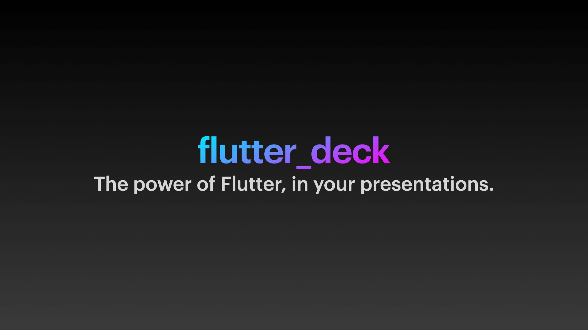

[](https://opensource.org/licenses/MIT)
[](https://flutterdeck.dev)


A lightweight, customizable, and easy-to-use framework to create presentations in Flutter.

Live demo: [https://flutterdeck.dev/demo](https://flutterdeck.dev/demo)

## 🪄 Features

- 💙 Slide deck is built as any other Flutter app.
- 🧭 Navigator 2.0 support - each slide is rendered as an individual page with a deep link to it.
- 🐾 Steps - each slide can have multiple steps that can be navigated through.
- 🎓 Presenter view - control your presentation from a separate screen or (even) device.
- ⚙️ Define a global configuration once and override it per slide if needed.
- 🚀 Predictable API to access the slide deck state and its methods from anywhere in the app.
- 📦 Out of the box slide templates, widgets, transitions and controls.
- 🎨 Custom theming and light/dark mode support.
- 🌍 Built-in localization support.

## 📚 Documentation

The official documentation is available at https://flutterdeck.dev.

## 📦 Packages

| Package                                                                                                       | Pub                                                                              | Description                                                                                                      |
| ------------------------------------------------------------------------------------------------------------- | -------------------------------------------------------------------------------- | ---------------------------------------------------------------------------------------------------------------- |
| [flutter_deck](https://pub.dev/packages/flutter_deck)                                                         |             | The core package that provides the main functionality to create presentations.                                   |
| [flutter_deck_client](https://pub.dev/packages/flutter_deck_client)                                           |      | A common client interface and models for the flutter_deck presenter view.                                        |
| [flutter_deck_web_client](https://pub.dev/packages/flutter_deck_web_client)                                   |  | A Web client implementation for the flutter_deck presenter view.                                                 |
| [flutter_deck_ws_client](https://pub.dev/packages/flutter_deck_ws_client)                                     |   | A WebSocket client implementation for the flutter_deck presenter view.                                           |
| [flutter_deck_ws_server](https://github.com/mkobuolys/flutter_deck/tree/main/packages/flutter_deck_ws_server) | -                                                                                | A WebSocket server for flutter_deck_ws_client implemented using [dart_frog](https://pub.dev/packages/dart_frog). |

## 💻 Installation

**❗ In order to start using flutter_deck you must have the [Flutter SDK](https://docs.flutter.dev/get-started/install) 3.47.0 or newer installed on your machine.**

Add `flutter_deck` and [`material_ui`](https://pub.dev/packages/material_ui) to your `pubspec.yaml`:

```yaml
dependencies:
  flutter_deck:
  material_ui:
```

Install it:

```sh
flutter packages get
```

flutter_deck is built on the standalone `material_ui` package, so import it instead of `package:flutter/material.dart` in your presentation code:

```dart
import 'package:flutter_deck/flutter_deck.dart';
import 'package:material_ui/material_ui.dart';
```

**🐧 Linux:** flutter_deck uses [`window_manager`](https://pub.dev/packages/window_manager), which compiles native code during the build, including `flutter test`. Install the GTK 3, X11 and Xi development packages on Linux machines and CI runners:

```sh
sudo apt-get install -y pkg-config libgtk-3-dev libx11-dev libxi-dev
```

## 👋 Hello flutter_deck!

Use `FlutterDeckApp` as your slide deck's root widget and pass a list of widgets as slides:

```dart
void main() {
  runApp(const FlutterDeckExample());
}

class FlutterDeckExample extends StatelessWidget {
  const FlutterDeckExample({super.key});

  @override
  Widget build(BuildContext context) {
    // This is an entry point for the Flutter Deck app.
    return FlutterDeckApp(
      configuration: const FlutterDeckConfiguration(...),
      slides: [
        <...>
      ],
    );
  }
}
```

Also, you can define a global configuration for your slide deck:

```dart
FlutterDeckApp(
  configuration: FlutterDeckConfiguration(
    background: const FlutterDeckBackgroundConfiguration(
      light: FlutterDeckBackground.solid(Color(0xFFB5FFFC)),
      dark: FlutterDeckBackground.solid(Color(0xFF16222A)),
    ),
    controls: const FlutterDeckControlsConfiguration(
      presenterToolbarVisible: true,
      gestures: FlutterDeckGesturesConfiguration.mobileOnly(),
      shortcuts: FlutterDeckShortcutsConfiguration(
        enabled: true,
        nextSlide: const {SingleActivator(LogicalKeyboardKey.arrowRight)},
        previousSlide: const {SingleActivator(LogicalKeyboardKey.arrowLeft)},
        toggleMarker: const {
          SingleActivator(
            LogicalKeyboardKey.keyM,
            control: true,
            meta: true,
          ),
        },
        toggleNavigationDrawer: const {
          SingleActivator(
            LogicalKeyboardKey.period,
            control: true,
            meta: true,
          ),
        },
      ),
    ),
    footer: const FlutterDeckFooterConfiguration(
      showSlideNumbers: true,
      widget: FlutterLogo(),
    ),
    header: const FlutterDeckHeaderConfiguration(
      showHeader: false,
    ),
    marker: const FlutterDeckMarkerConfiguration(
      color: Colors.cyan,
      strokeWidth: 8.0,
    ),
    progressIndicator: const FlutterDeckProgressIndicator.gradient(
      gradient: LinearGradient(
        begin: Alignment.topLeft,
        end: Alignment.bottomRight,
        colors: [Colors.pink, Colors.purple],
      ),
      backgroundColor: Colors.black,
    ),
    slideSize: FlutterDeckSlideSize.fromAspectRatio(
      aspectRatio: const FlutterDeckAspectRatio.ratio16x10(),
      resolution: const FlutterDeckResolution.fromWidth(1440),
    ),
    transition: const FlutterDeckTransition.fade(),
  ),
  <...>
);
```

Use any colors you like:

```dart
FlutterDeckApp(
  lightTheme: FlutterDeckThemeData.light(),
  darkTheme: FlutterDeckThemeData.dark(),
  themeMode: ThemeMode.system,
  <...>
);
```

And do not forget to introduce yourself!

```dart
FlutterDeckApp(
  speakerInfo: const FlutterDeckSpeakerInfo(
    name: 'John Doe',
    description: 'CEO of flutter_deck',
    socialHandle: '@john_doe',
    imagePath: 'assets/me.png',
  ),
  <...>
);
```

## 🧑‍💻 Maintainers

- [Mangirdas Kazlauskas](https://github.com/mkobuolys)
